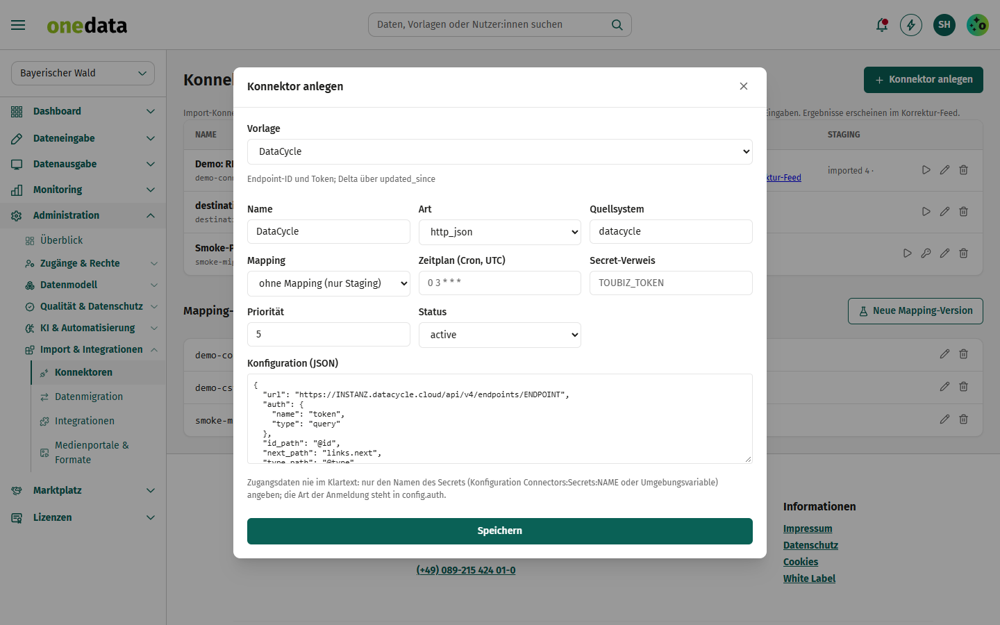
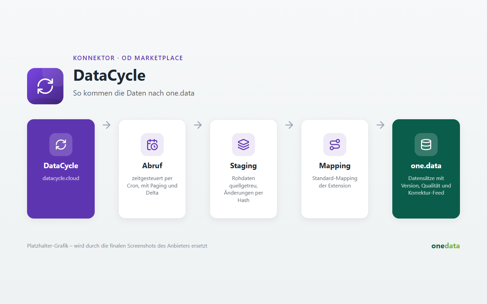

# DataCycle

## Anbieter

**destination.one GmbH** – Hersteller von one.data. Diese Extension gehört zum offiziellen Katalog
[one-data-extensions](https://github.com/audioholic-78/one-data-extensions) und wird mit one.data gepflegt.

- Web: [www.destination.one](https://www.destination.one)
- Kontakt: [info@destination.one](mailto:info@destination.one)

## Kurzbeschreibung

JSON-LD-Endpunkte aus DataCycle mit Delta-Abruf übernehmen.

## Beschreibung





Beim Anlegen unter *Administration → Konnektoren* ist die Konfiguration vorbelegt. Platzhalter in Großbuchstaben (z. B. `PROJEKT`, `INSTANZ`) ersetzen und Zugangsdaten nur als **Name eines Secrets** (`credentials_ref`) hinterlegen.

**Hinweis:** Endpoint-ID und Token; Delta über updated_since.

### Konfiguration

```json
{
  "url": "https://INSTANZ.datacycle.cloud/api/v4/endpoints/ENDPOINT",
  "items_path": "@graph",
  "id_path": "@id",
  "type_path": "@type",
  "next_path": "links.next",
  "since_param": "filter[updated_since]",
  "auth": {
    "type": "query",
    "name": "token"
  }
}
```

Das Mapping auf den one.data-Datenstandard wird je Instanz unter *Konnektoren → Mapping* gepflegt.
