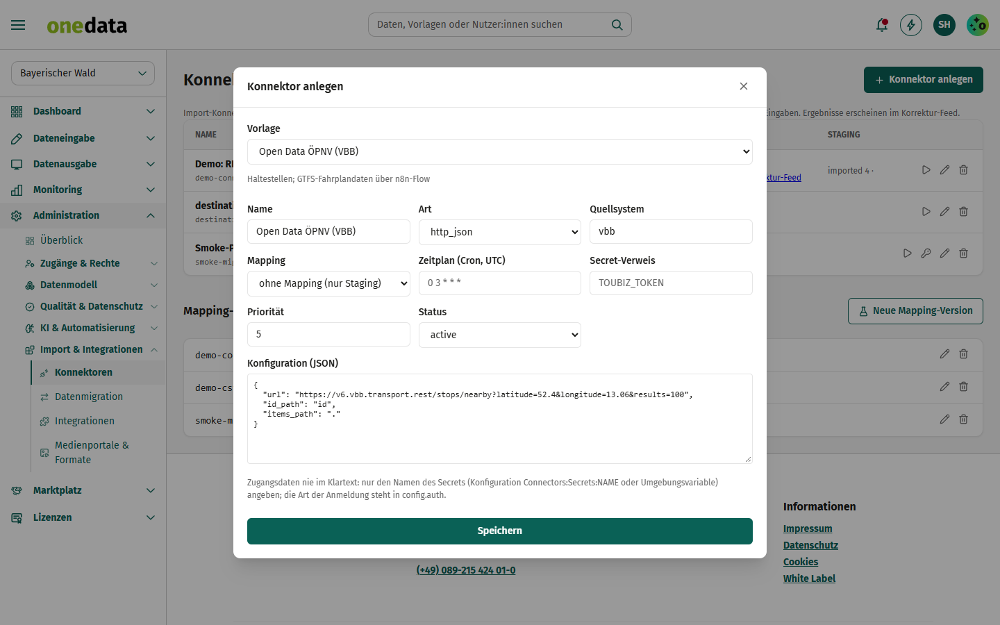
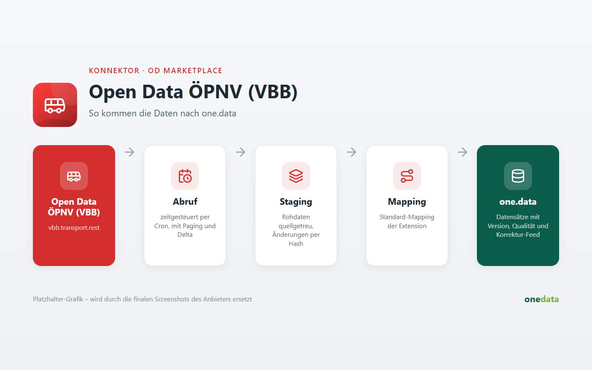

# Open Data ÖPNV (VBB)

## Anbieter

**destination.one GmbH** – Hersteller von one.data. Diese Extension gehört zum offiziellen Katalog
[one-data-extensions](https://github.com/audioholic-78/one-data-extensions) und wird mit one.data gepflegt.

- Web: [www.destination.one](https://www.destination.one)
- Kontakt: [info@destination.one](mailto:info@destination.one)

## Kurzbeschreibung

Haltestellen des Verkehrsverbunds Berlin-Brandenburg übernehmen.

## Beschreibung





Beim Anlegen unter *Administration → Konnektoren* ist die Konfiguration vorbelegt. Platzhalter in Großbuchstaben (z. B. `PROJEKT`, `INSTANZ`) ersetzen und Zugangsdaten nur als **Name eines Secrets** (`credentials_ref`) hinterlegen.

**Hinweis:** Haltestellen; GTFS-Fahrplandaten über n8n-Flow.

### Konfiguration

```json
{
  "url": "https://v6.vbb.transport.rest/stops/nearby?latitude=52.4&longitude=13.06&results=100",
  "items_path": ".",
  "id_path": "id"
}
```

Das Mapping auf den one.data-Datenstandard wird je Instanz unter *Konnektoren → Mapping* gepflegt.
