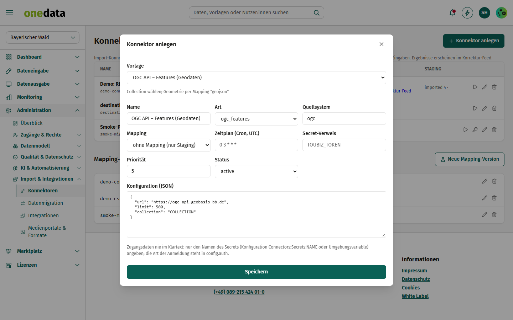
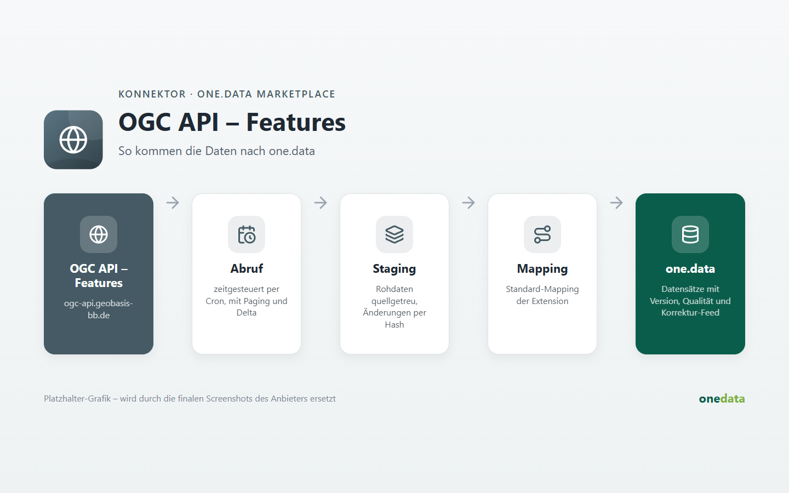

# OGC API – Features (Geodaten)

## Anbieter

**destination.one GmbH** – Hersteller von one.data. Diese Extension gehört zum offiziellen Katalog
[onedata-ext](https://github.com/audioholic-78/onedata-ext) und wird mit one.data gepflegt.

- Web: [www.destination.one](https://www.destination.one)
- Kontakt: [info@destination.one](mailto:info@destination.one)

## Kurzbeschreibung

Geodaten aus einer OGC-API-Features-Schnittstelle übernehmen (inkl. Geometrien).

## Beschreibung





Beim Anlegen unter *Administration → Konnektoren* ist die Konfiguration vorbelegt. Platzhalter in Großbuchstaben (z. B. `PROJEKT`, `INSTANZ`) ersetzen und Zugangsdaten nur als **Name eines Secrets** (`credentials_ref`) hinterlegen.

**Hinweis:** Collection wählen; Geometrie per Mapping "geojson".

### Konfiguration

```json
{
  "url": "https://ogc-api.geobasis-bb.de",
  "collection": "COLLECTION",
  "limit": 500
}
```

Das Mapping auf den one.data-Datenstandard wird je Instanz unter *Konnektoren → Mapping* gepflegt.
