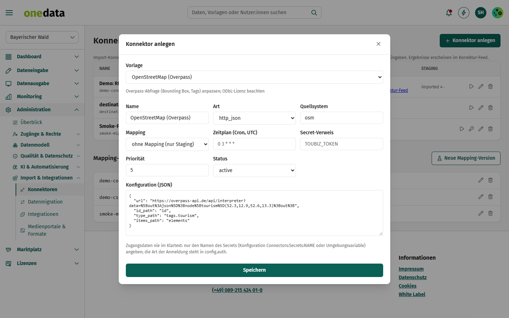
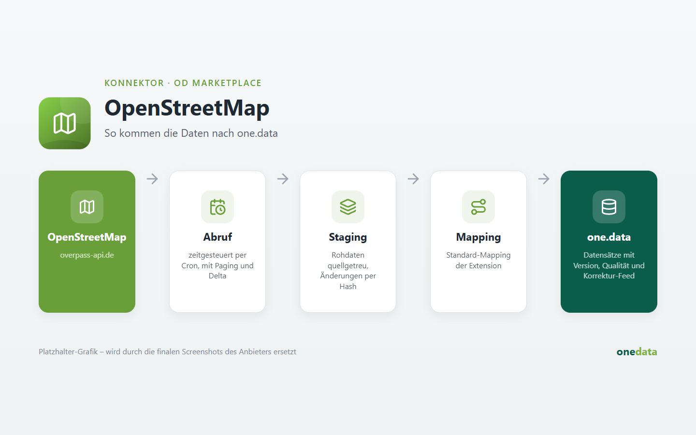

# OpenStreetMap (Overpass)

## Anbieter

**destination.one GmbH** – Hersteller von one.data. Diese Extension gehört zum offiziellen Katalog
[one-data-extensions](https://github.com/audioholic-78/one-data-extensions) und wird mit one.data gepflegt.

- Web: [www.destination.one](https://www.destination.one)
- Kontakt: [info@destination.one](mailto:info@destination.one)

## Kurzbeschreibung

Touristische Orte aus OpenStreetMap über eine Overpass-Abfrage übernehmen.

## Beschreibung





Beim Anlegen unter *Administration → Konnektoren* ist die Konfiguration vorbelegt. Platzhalter in Großbuchstaben (z. B. `PROJEKT`, `INSTANZ`) ersetzen und Zugangsdaten nur als **Name eines Secrets** (`credentials_ref`) hinterlegen.

**Hinweis:** Overpass-Abfrage (Bounding Box, Tags) anpassen; ODbL-Lizenz beachten.

### Konfiguration

```json
{
  "url": "https://overpass-api.de/api/interpreter?data=%5Bout%3Ajson%5D%3Bnode%5Btourism%5D(52.3,12.9,52.6,13.3)%3Bout%3B",
  "items_path": "elements",
  "id_path": "id",
  "type_path": "tags.tourism"
}
```

Das Mapping auf den one.data-Datenstandard wird je Instanz unter *Konnektoren → Mapping* gepflegt.
