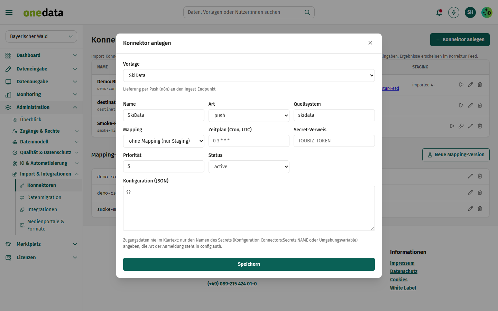
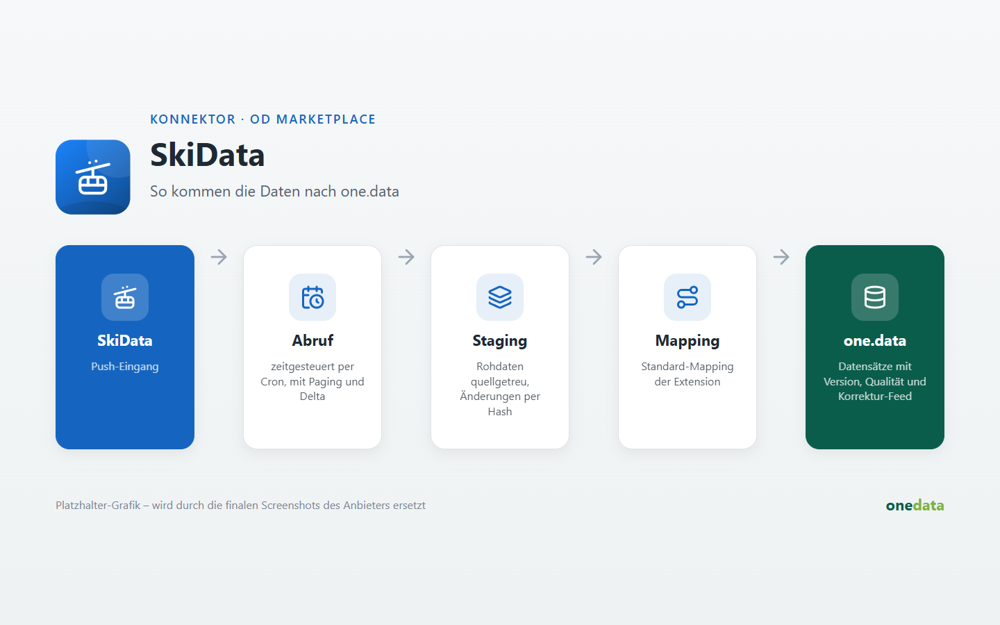

# SkiData

## Anbieter

**destination.one GmbH** – Hersteller von one.data. Diese Extension gehört zum offiziellen Katalog
[one-data-extensions](https://github.com/audioholic-78/one-data-extensions) und wird mit one.data gepflegt.

- Web: [www.destination.one](https://www.destination.one)
- Kontakt: [info@destination.one](mailto:info@destination.one)

## Kurzbeschreibung

Lift- und Ticketdaten von SkiData per Push-Lieferung empfangen.

## Beschreibung





Dieser Konnektor ruft selbst nichts ab: Unter *Konnektoren* ein **Ingest-Token** erzeugen und die Daten per `POST /v1/connectors/{id}/ingest` (Header `X-Ingest-Token`) liefern.

**Hinweis:** Lieferung per Push (n8n) an den Ingest-Endpunkt.

### Konfiguration

```json
{}
```

Das Mapping auf den one.data-Datenstandard wird je Instanz unter *Konnektoren → Mapping* gepflegt.
