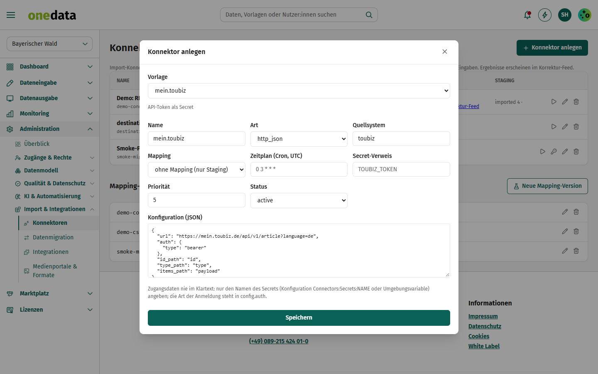
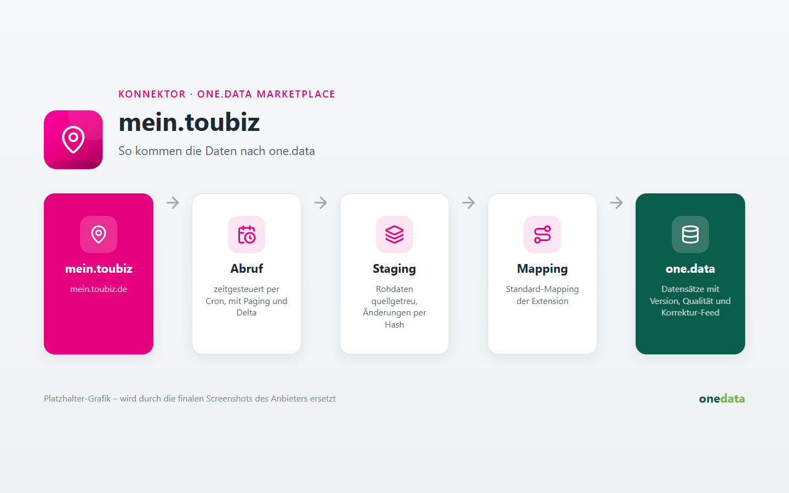

# mein.toubiz

## Anbieter

**destination.one GmbH** – Hersteller von one.data. Diese Extension gehört zum offiziellen Katalog
[onedata-ext](https://github.com/audioholic-78/onedata-ext) und wird mit one.data gepflegt.

- Web: [www.destination.one](https://www.destination.one)
- Kontakt: [info@destination.one](mailto:info@destination.one)

## Kurzbeschreibung

Artikel (POI, Gastronomie, Veranstaltungen) aus mein.toubiz abrufen.

## Beschreibung





Beim Anlegen unter *Administration → Konnektoren* ist die Konfiguration vorbelegt. Platzhalter in Großbuchstaben (z. B. `PROJEKT`, `INSTANZ`) ersetzen und Zugangsdaten nur als **Name eines Secrets** (`credentials_ref`) hinterlegen.

**Hinweis:** API-Token als Secret.

### Konfiguration

```json
{
  "url": "https://mein.toubiz.de/api/v1/article?language=de",
  "items_path": "payload",
  "id_path": "id",
  "type_path": "type",
  "auth": {
    "type": "bearer"
  }
}
```

Das Mapping auf den one.data-Datenstandard wird je Instanz unter *Konnektoren → Mapping* gepflegt.
