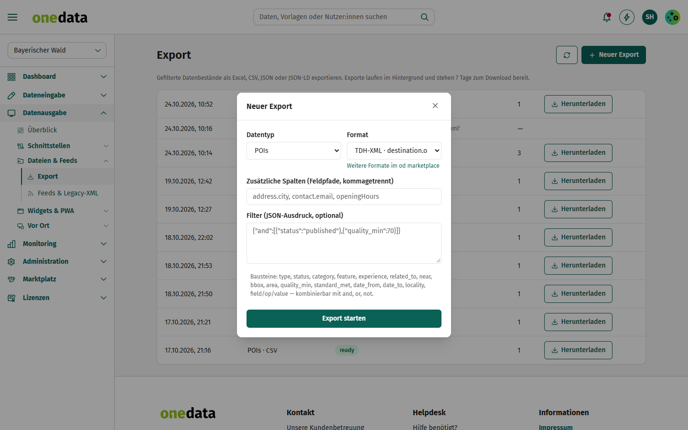
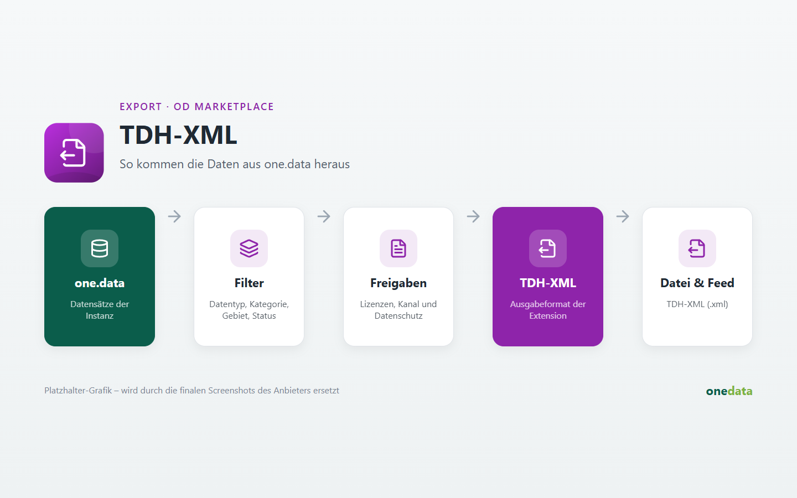

# TDH-XML

## Anbieter

**destination.one GmbH** – Hersteller von one.data. Diese Extension gehört zum offiziellen Katalog
[one-data-extensions](https://github.com/audioholic-78/one-data-extensions) und wird mit one.data gepflegt.

- Web: [www.destination.one](https://www.destination.one)
- Kontakt: [info@destination.one](mailto:info@destination.one)

## Kurzbeschreibung

Ausgabe im XML-Format des Tourismus-Datenhubs (Legacy-Schnittstelle).

## Beschreibung

Eingebautes Format von one.data (`xml_tdh`), hier als Extension aktivierbar. Nach der Aktivierung steht es unter *Datenausgabe → Dateien & Feeds* für Exporte und Feeds zur Verfügung. Bestehende Feeds mit diesem Format laufen unabhängig von der Aktivierung weiter.
