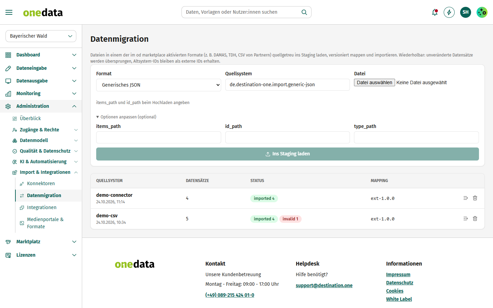
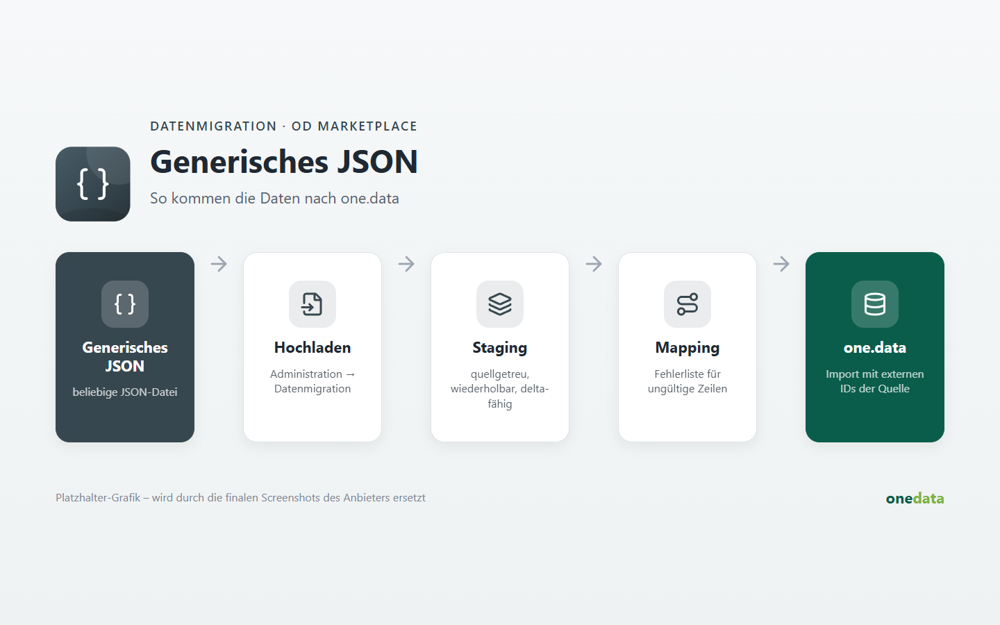

# Generisches JSON

## Anbieter

**destination.one GmbH** – Hersteller von one.data. Diese Extension gehört zum offiziellen Katalog
[one-data-extensions](https://github.com/audioholic-78/one-data-extensions) und wird mit one.data gepflegt.

- Web: [www.destination.one](https://www.destination.one)
- Kontakt: [info@destination.one](mailto:info@destination.one)

## Kurzbeschreibung

Beliebige JSON-Dateien (Liste oder Objekt mit Liste): Pfade beim Hochladen frei wählbar.

## Beschreibung





Unter *Administration → Datenmigration* das Format wählen und die Datei hochladen. Die Datensätze landen quellgetreu im Staging; danach eine Mapping-Version wählen und importieren.

**Hinweis:** items_path und id_path beim Hochladen angeben.

### Optionen

```json
{
  "items_path": ".",
  "id_path": "id"
}
```
