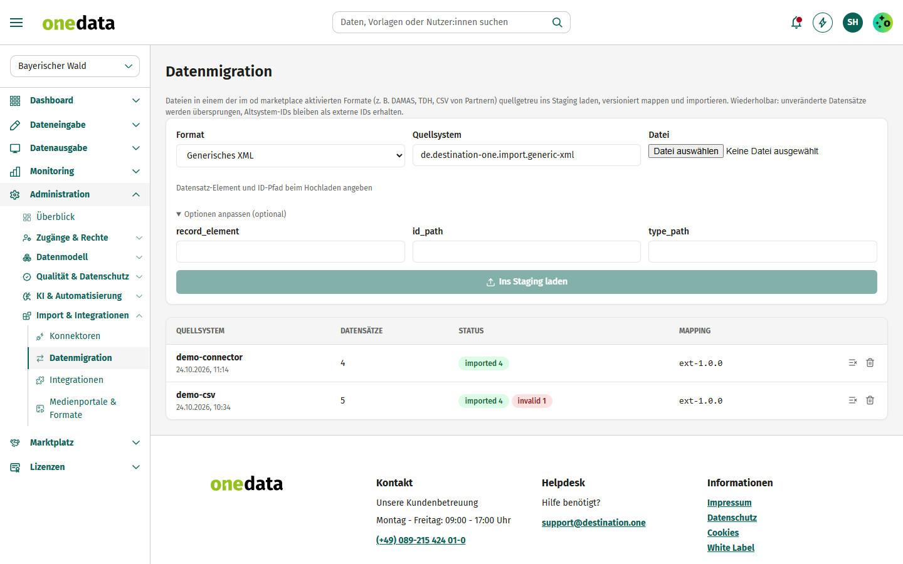
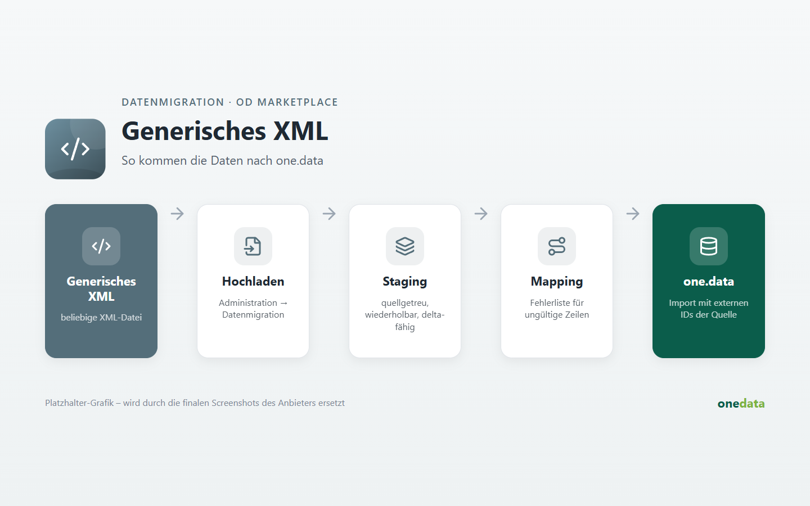

# Generisches XML

## Anbieter

**destination.one GmbH** – Hersteller von one.data. Diese Extension gehört zum offiziellen Katalog
[onedata-ext](https://github.com/audioholic-78/onedata-ext) und wird mit one.data gepflegt.

- Web: [www.destination.one](https://www.destination.one)
- Kontakt: [info@destination.one](mailto:info@destination.one)

## Kurzbeschreibung

Beliebige XML-Dateien: Datensatz-Element und ID-Pfad sind beim Hochladen frei wählbar.

## Beschreibung





Unter *Administration → Datenmigration* das Format wählen und die Datei hochladen. Die Datensätze landen quellgetreu im Staging; danach eine Mapping-Version wählen und importieren.

**Hinweis:** Datensatz-Element und ID-Pfad beim Hochladen angeben.

### Optionen

```json
{
  "record_element": "item",
  "id_path": "@id"
}
```
